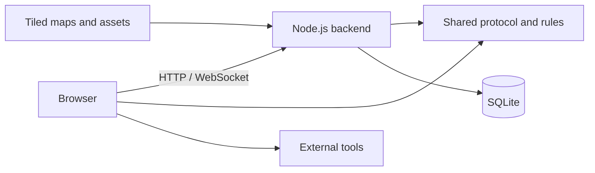

# Architecture

This document describes the system components, ownership of key data, and how features are integrated. See the [README](../README.md) for setup, [Tiled map authoring](tiled.en.md), [account rules](account-system.en.md), and the [external tool contract](external-tools.en.md).

## System components

Impartation consists of a browser client, a Node.js backend, a shared protocol package, and map assets. The browser uses HTTP for account, map, and entry configuration, and joins live spaces over Colyseus WebSocket.

| Component | Responsibility |
| --- | --- |
| `apps/frontend` | Account UI, Phaser map scene, and Colyseus client |
| `apps/backend` | Identity API, authoritative live state, map service, and built-in interactions |
| `packages/shared` | Shared protocol types, schemas, and map rules |
| `assets/maps` | Map registry, Tiled files, tilesets, and map images |
| SQLite | Account profiles, saved outfits, board posts, and admin commands |
| External services | Manage their own content, accounts, permissions, and persistence |

The frontend depends only on protocol types exported by `packages/shared`, not backend source types. The shared package explicitly defines the room protocol; frontend types, server validation, and handlers must stay aligned when messages change.

## Joining a space and map

The map registry defines the ordered list of Spaces and each Space's maps, initial map, and default spawn. The client reads `/api/world` to display Spaces. After a user selects one, the server validates the account session and `spaceId` before joining its Colyseus room.

At most one live room exists per Space. A room owns that Space's players, chat, voice signaling, map object state, and temporary interaction state. Players can move among maps registered for the Space without leaving the room or account connection. The server validates destination maps and spawn points for both Portals and map-menu navigation.

The server reads Tiled JSON to build map semantics for movement, collision, and interaction checks, along with normalized map data for browser rendering. The server owns writes to position, identity, map membership, and interaction authorization; the client submits input and displays synchronized state. See the [Tiled guide](tiled.en.md) for map format, authoring, and rendering limits.

## State ownership and isolation

| Data | Ownership and lifecycle |
| --- | --- |
| Accounts, profiles, outfit slots | Better Auth and SQLite; persisted per account and shared across Spaces |
| Player positions, chat, voice signaling | Current Space room; isolated between Spaces and not restored after room destruction |
| Map objects, action occupancy, private-area sessions | Current Space room, isolated by map ID |
| Board posts | SQLite, persisted by `(space_id, resourceId)` |
| Pomodoro timer | Current Space room, shared by `resourceId`; resets when the room is recreated |
| Map and WebTool catalogs | Loaded at backend startup and shared by the instance |
| External tool content | Owned by the external service; this project stores only public entry configuration |

Identity comes from a server-validated Better Auth session. A client-supplied user ID, nickname, or role does not grant access. For each protected live operation, the server checks the verified identity, authoritative position, and interaction rules.

A private area is temporary membership context within a Space room, not a separate room or account-level ACL. The server controls entry and filters chat and voice recipients by area. Position and typing indicators remain visible to other members of the same room. See [account rules](account-system.en.md) and [integration boundaries](integrations.en.md).

## Interaction extension boundary

Map interactions are declared in the Tiled `interactions` object layer. `packages/shared` provides the generic `InteractionRegistry<T>` for interaction definitions; frontend and backend assemble their implementations in their own `interactions` modules.

Server handlers validate identity, map position, permissions, and business input. Client handlers present UI, send requests, and clean up subscriptions and DOM. Interactions must release their resources when a user leaves an area, disconnects, or the interaction is destroyed. Shared resources use `resourceId`; map object IDs locate map state and do not replace identity or permission checks.

Built-in interactions include Portals, boards, Pomodoro timers, wardrobes, action anchors, variant selectors, and private areas. External entries use the `web` type and resolve `resourceId` through `EXTERNAL_TOOLS`; clicking opens a new tab or sandboxed iframe. The project does not proxy external traffic, map project identities, or manage tool containers. See [external tool configuration](external-tools.en.md) for configuration and browser security boundaries.

## Deployment boundary

The current deployment uses one backend instance and local SQLite. Space rooms, queues, and live interaction state are held in process memory. Supporting more backend replicas requires cross-process room routing, persistence, and state notifications. Persist and back up the SQLite data directory. If HTTP Basic Auth is needed, configure it in the deployer's reverse proxy.

The HTTP API exposes the public map catalog, normalized map assets, public WebTool configuration, and WebRTC ICE configuration. Account and admin APIs require a server-validated session. Maps and tool configuration load at startup and require a backend restart after changes. See the README and [hosting guide](hosting.en.md) for environment variables, proxy, and deployment steps.

Test commands, coverage, and automation limits are documented in the [testing guide](testing.en.md).
