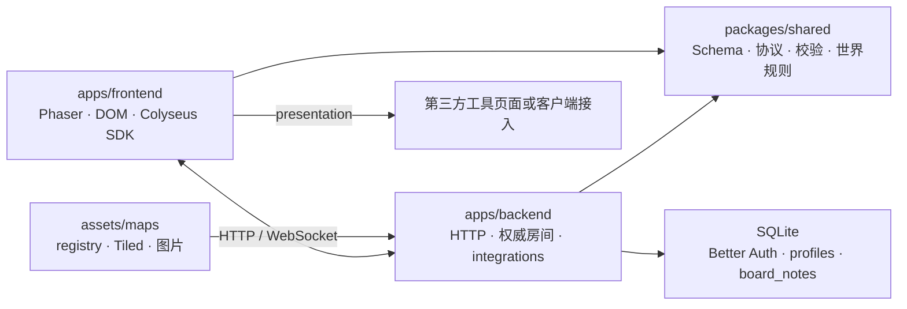
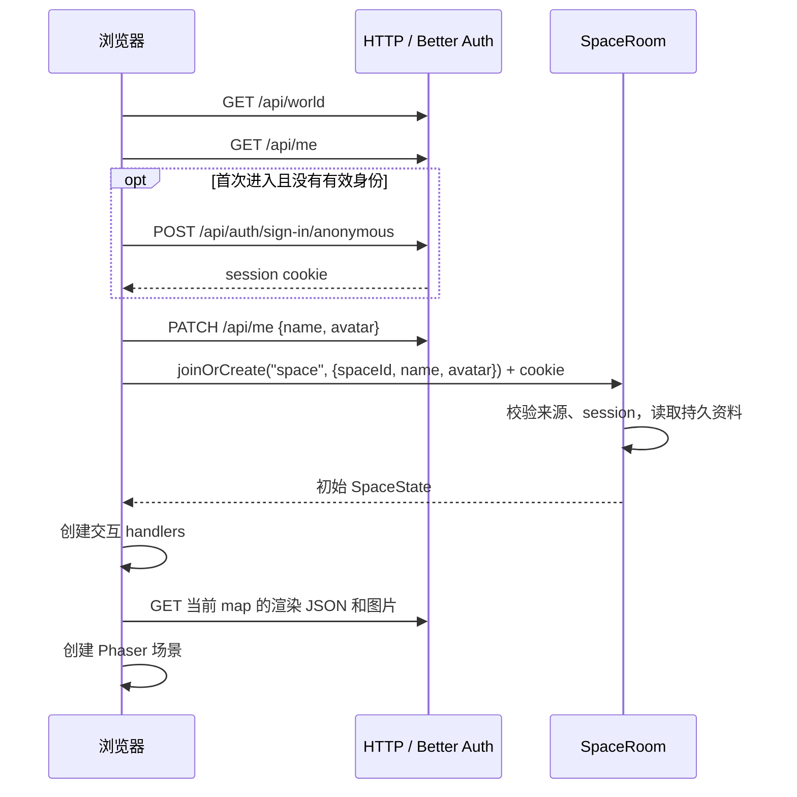

# 工程架构

本文描述当前代码的组织方式、运行流程和扩展契约。启动命令见 [README](../README.md)，地图格式见 [Tiled 契约](tiled.md)，身份 API 和绑定流程见 [身份说明](account-system.md)，工具配置见 [integration 配置](integration-plan.md)。尚未实现的能力见 [待办](roadmap.md)。

Virtual Workspace 由浏览器客户端和一个 Node.js 后端组成。浏览器使用 Phaser 4 渲染地图，通过 HTTP 获取身份、地图和工具配置，通过 Colyseus 0.18 WebSocket 收发输入、状态和交互请求。后端拥有玩家位置、地图归属和内置 integration 状态的写入权；SQLite 保存身份、资料和留言。Tiled 文件决定世界几何与交互语义，第三方服务拥有自己的内容、账号和权限。

## 1. 代码结构与依赖方向

仓库使用 npm workspaces，要求 Node.js 24 或更新版本，所有 workspace 启用 TypeScript strict。



前端不依赖 backend 包或服务端类型。客户端可见的 Colyseus Schema 和 `SpaceProtocol` 都从 shared 导出；数据库、认证 token 和服务端 handler 留在 backend。

| 路径 / 入口 | 职责 |
| --- | --- |
| [shared/index.ts](../packages/shared/src/index.ts) | Schema、消息输入校验、`WebTool` 配置类型、公共常量 |
| [shared/protocol.ts](../packages/shared/src/protocol.ts) | SDK 使用的 `SpaceProtocol` 结构类型，定义房间输入、请求响应及服务端消息 |
| [shared/world.ts](../packages/shared/src/world.ts) | Tiled 语义提取、registry 校验、动作锚点重叠解析、碰撞和移动函数 |
| [shared/character.ts](../packages/shared/src/character.ts) | 角色朝向和激活载荷的共享类型与校验 |
| [shared/interactions.ts](../packages/shared/src/interactions.ts) | 泛型 `InteractionRegistry<T>`，按 kind 注册、查询和遍历；拒绝空 kind 和重复注册 |
| [backend/app.config.ts](../apps/backend/src/app.config.ts) | 注册 `space` 房间、WebSocket transport 和 HTTP 路由 |
| [backend/rooms/SpaceRoom.ts](../apps/backend/src/rooms/SpaceRoom.ts) | 房间生命周期、身份复验、移动、聊天及交互授权上下文 |
| [backend/world.ts](../apps/backend/src/world.ts) | 读取地图 registry，生成权威世界和浏览器可加载的渲染资源 |
| [backend/interactions/index.ts](../apps/backend/src/interactions/index.ts) | 服务端交互组装入口；注册 action、variantSelector、privateArea、board、pomodoro 和 Portal |
| [backend/interactions/context.ts](../apps/backend/src/interactions/context.ts) / [registry.ts](../apps/backend/src/interactions/registry.ts) | 服务端通用交互上下文、消息与生命周期组合 |
| [backend/interactions/web/config.ts](../apps/backend/src/interactions/web/config.ts) | 解析并校验公开 WebTool 配置 |
| [backend/identity.ts](../apps/backend/src/identity.ts) / [db.ts](../apps/backend/src/db.ts) | Better Auth、项目资料、数据库初始化和迁移 |
| [frontend/main.ts](../apps/frontend/src/main.ts) | 页面与连接生命周期、地图获取和切换、聊天、顶层清理 |
| [frontend/SpaceScene.ts](../apps/frontend/src/SpaceScene.ts) | Tiled 瓦片渲染、角色插值、键盘输入和区域通知 |
| [frontend/interactions/index.ts](../apps/frontend/src/interactions/index.ts) | 客户端交互组装入口；注册面板、Portal 和 WebTool handler |
| [frontend/interactions/dispatcher.ts](../apps/frontend/src/interactions/dispatcher.ts) | 通用区域、连接和销毁事件分发 |
| [frontend/interactions/board/handler.ts](../apps/frontend/src/interactions/board/handler.ts) / [pomodoro/handler.ts](../apps/frontend/src/interactions/pomodoro/handler.ts) / [portal/handler.ts](../apps/frontend/src/interactions/portal/handler.ts) | 内置面板和 Portal 客户端交互 |
| [frontend/interactions/web/handler.ts](../apps/frontend/src/interactions/web/handler.ts) / [web/presentations.ts](../apps/frontend/src/interactions/web/presentations.ts) | 按 resourceId 查找 WebTool 配置并呈现页面 |

shared 编译到 `packages/shared/dist`，同时输出 JavaScript 和声明文件；workspace 引用通过 package exports 读取这些产物。backend 使用 NodeNext，编译到 `apps/backend/build`；frontend 使用 Vite，产物位于 `apps/frontend/dist`。根脚本先构建 shared，避免其它 workspace 使用过期或缺失的协议产物。

`SpaceProtocol` 是显式维护的公共契约，并非从 backend 自动生成。修改消息时，需要同步 shared 的协议、输入校验和服务端实现。[架构测试](../apps/backend/test/architecture.test.ts) 在编译时比较两侧载荷及请求结果类型，同时检查前端没有 backend 依赖。

## 2. 启动与进入空间

后端入口 [index.ts](../apps/backend/src/index.ts) 调用 `listen(server, config.PORT)`。监听前，模块初始化完成以下工作：

1. [config.ts](../apps/backend/src/config.ts) 用 Zod 解析环境变量；生产环境检查身份配置。
2. 打开 SQLite，执行项目表迁移和 Better Auth 自身的 schema migration。
3. 读取 `MAP_REGISTRY_PATH` 指定的 registry 和所有地图，校验语义、默认 spawn 与 Portal 目标，建立渲染 JSON 和资源索引。
4. 解析 `EXTERNAL_TOOLS`，检查配置资源对应地图中的 `web` 区域。
5. 注册 HTTP 路由和 `space` 房间类型。具体房间由 matchmaking 按需创建。

数据库迁移、地图或工具配置出错会阻止正常启动。地图和配置在启动时读入内存；当前没有运行时重新加载机制，更改后需重启后端。

浏览器的进入流程由 `main.ts` 和 [identity.ts](../apps/frontend/src/identity.ts) 协作完成：



打开页面只尝试恢复已有资料；提交进入表单时才按需创建匿名身份并保存资料。客户端校验 `/api/world` 响应并从按 registry 顺序显示的 Space 列表中选择一个，加入时提交其 `spaceId`；等待房间初始状态后，用本玩家 `mapId` 选择地图。所选 Space 的 `initialMap` 是初始入口。

界面相关的前端模块只处理本地展示：[theme.ts](../apps/frontend/src/theme.ts) 把 6 套预设或由底色/面板/描边/按钮四色推导的自定义配色写成根元素 CSS 变量；[wardrobe.ts](../apps/frontend/src/wardrobe.ts) 管理试衣间的图层选择、单品预览、预设色与撤销；[colorPicker.ts](../apps/frontend/src/colorPicker.ts) 提供饱和度/明度面板、色相条和 RGB/HEX 输入，并标出 shared `SOFT_COLOR_ZONE` 柔和区；[outfitSlots.ts](../apps/frontend/src/outfitSlots.ts) 在浏览器中保存 3 个命名造型。界面配色、造型槽位、柔和区锁定、昵称显隐和聊天背景都只存在 localStorage，不进入身份资料或房间状态，也不跨设备同步；服务端仍只按 `appearanceSchema` 校验六位 RGB，不强制柔和区。保存造型槽位时会同时调用 `PATCH /api/me` 保存当前造型。

Colyseus 使用公共 `space` 房间类型；客户端以必填 `spaceId` 匹配对应 Space。每个 Space 同时最多一个 live room，所有 Space 共用 `SPACE_MAX_CLIENTS`（默认 32）；满员时拒绝加入，不创建额外实例。房间只包含该 Space 登记的地图，地图 ID 不是房间 ID。私密区域是在 Space room 中的临时区域上下文，包含成员名单和物理准入；不创建新的 Colyseus 房间。

## 3. 世界数据：Tiled 到权威状态与画面

### 3.1 同一源数据的两种用途

[loadWorldRegistry](../apps/backend/src/world.ts) 对每个 registry 条目读取 `.tmj`，分别产生：

| 产物 | 消费方 | 内容 |
| --- | --- | --- |
| `WorldMap` | 服务端移动/授权；客户端区域及动作锚点显示 | 像素宽高、命名 `spawns`、碰撞矩形 `collisions`、交互矩形 `zones`、动作锚点 `actions`、选择器 `selectors` 和变体目标 `variantTargets` |
| 规范化 Tiled JSON | Phaser | 保留地图渲染数据；外置 JSON tileset 展开，图片路径改写为地图资源 API URL |
| 资源索引 | HTTP 资源路由 | 该地图显式引用的图片文件与服务端生成的 asset ID 对应关系 |

registry 的 `maps` 配置条目是 `{ id, file, defaultSpawn }`；`spaces` 定义每个 Space 的初始地图和成员地图。`file` 相对 registry 文件所在目录解析；map ID 不要求与文件名相同。公共目录响应为 `{ maps, spaces }`，其中地图条目是 `{ id, url, defaultSpawn, world }`，不暴露源文件路径。客户端使用 `url` 获取渲染数据，无需知道默认示例地图的文件名。

registry 校验要求 map ID 和 Space ID 各自唯一、每个 Space 的 initialMap 属于自身地图集合、各成员地图 defaultSpawn 存在，并逐 Space 验证 Portal 的目标地图和 spawn。map ID、zone ID、spawn 名称采用非空、最多 128 字符的标识约束，已知资源型交互的 resourceId 也采用该约束；未知 kind 可不提供 resourceId。zone ID 和 spawn 名称在各自地图内唯一，resourceId 可以跨地图复用。

所有坐标和移动规则使用像素。标准 tile 为 16×16；地图宽高从 tile 数换算为像素。tile 不直接决定碰撞，服务端碰撞来自 Tiled 的语义对象层。

### 3.2 项目语义校验

`parseWorldMap` 要求有限、正交、16×16 tile 的地图，以及以下三个对象层。层名在整张地图中各出现一次，可以嵌套在 group 中；group 和 layer 的位置偏移会累加到语义坐标。

| 对象层 | 提取规则 |
| --- | --- |
| `spawns` | 至少一个命名 point；名称唯一，按玩家碰撞体检查可站立性 |
| `collisions` | 地图内的非旋转、正面积轴对齐矩形；可为空 |
| `interactions` | 区域为地图内的非旋转、正面积轴对齐矩形；动作锚点为可站立的点；可为空；旧 action/区域保留 `name` ID；新增 variantSelector/privateArea/wardrobe 使用 Tiled 数字 object ID 的字符串形式 |

`interactions` 层也可包含动作锚点：`class` 为 `action` 的对象必须是命名 point，string property `action` 指定动作名称。可选 `facing` 声明对齐到锚点所需朝向；交互不会自动转身。`offsetX`/`offsetY` 指定世界像素偏移，`linkedObjectId` 保留地图对象关联。有效锚点必须可站立；每个动作名称在每个 16×16 格最多一个锚点，不同动作可共格。服务端以玩家 12×8 脚底矩形与锚点 tile 的正面积重叠查找候选；最近候选优先，等距按稳定对象 ID 的字符串顺序决定。最近候选朝向不符时动作原地执行，保持位置和朝向、清空 `actionTargetId` 并释放先前认领；不对齐或认领锚点，不打开变体选择器或自动应用变体。最近候选朝向相符但已被占用时直接拒绝，不尝试更远锚点。有效请求吸附到偏移位置，并沿吸附路径按短于脚底矩形尺寸的步长检查权威碰撞与私密区域限制；没有重叠候选时动作原地执行。ID 在地图间可重复，运行时状态通过 map ID 隔离。

交互 kind 取对象 `class`，没有 class 时使用 `type`；properties 保存为 `Record<string, unknown>`。`resourceId` 是从 properties 提取的共享资源标识，与 zone ID 不同：多个区域或地图可以引用同一资源。Portal 使用 `targetMap` 和 `targetSpawn`。

已注册的交互定义负责 kind 特有的语义校验。类型决定配置和校验：action 和 variantSelector 使用各自的点配置 schema；privateArea 与 wardrobe 使用矩形定义，暂无额外必填属性；board、pomodoro 和 `web` 检查非空 resourceId，Portal 检查目标属性。所有内置类型校验所需属性类型及几何，重复属性名被拒绝。未知 kind 仍可解析，不因缺少内置 handler 而拒绝地图；若需要特定属性约束，应注册定义，或向 `parseWorldMap` 传入自定义 registry。定义注册不会自动创建客户端或服务端 handler。

校验范围与渲染能力分开。其它对象层中的装饰对象保持不透明；只有被 variantSelector 引用的目标矩形或 tile object 需要校验目标几何、可选基础 GID 与 `variant.<名称>` local tile ID。单 tileset 地图默认选择该 tileset，多 tileset 地图要求目标提供 `variantTileset`；共享解析器根据展开后的 tileset 元数据解析成运行时 map GID。多个 tile layer 或额外 Tiled 元数据也不会仅因当前画面不需要而被语义解析器拒绝。语义层的可见性不控制碰撞或授权。

普通区域按解析顺序选择第一个包含脚点的矩形；没有普通区域时才以 privateArea 作为 zoneId。privateAreaId 独立计算，因此私密房间内的镜子、web 入口和 Portal 不会覆盖成员上下文。privateArea 矩形互不重叠，普通区域可放在其中。包含判断左/上边界闭合、右/下边界开放。

### 3.3 渲染加载和支持边界

后端支持内嵌 tileset 和外置 JSON `.tsj`，解析其图片引用，递归改写 group 内 image layer 的图片路径。资源路由仅接受已建立索引的 map/asset ID；没有任意文件路径下载接口。地图与 tileset 是部署者控制的可信文件，加载器允许其引用文件系统资源，制图文件本身不是面向不可信上传的沙盒。

`SpaceScene.preload` 把规范化 JSON 交给 Phaser Tiled parser，并加载带顶层 `image` 的 atlas tileset。`create` 按 Phaser 解析得到的 tile layer 顺序创建图层，使用全部已加载 atlas；不要求图层叫 ground，也不要求只有一张内嵌 tileset。玩家和交互区提示在瓦片层之后绘制。

当前实现覆盖 atlas tileset、多个瓦片层及 group 内的瓦片层。外置 XML `.tsx` 没有转换器；image collection tileset、image layer 和通用 tile object 没有相应的客户端绘制实现。variantSelector 引用的矩形或直立 tile object 有专用 atlas 绘制路径，按目标尺寸绘制底边锚定的图块，深度高于同底边的 ySort 图块；不支持翻转 GID、旋转或 image collection tileset。后端保留/改写这些数据不表示前端已经支持绘制。新增 Tiled 视觉支持应改动加载或渲染路径，不应顺便收紧无关语义校验。

地图逻辑尺寸来自 registry 中的 world。浏览器相机默认倍率按 Tiled 图块宽高中较大的一边计算：取最接近 `48 / tileSize` 的整数，并限制在 1–6；16×16 图块默认用 3x。浏览器设置可选自动或固定 1x–6x，按浏览器保存并立即应用。Phaser camera zoom 同时作用于地图、角色和对象视觉，Tiled 像素坐标、出生点、碰撞和服务端移动规则保持原值。昵称与区域文字按屏幕尺寸保持可读；昵称绘制在角色脚点下方，不随动作改变文字。registry 不限制地图纵横比；全屏画布由 RESIZE 适配窗口。

## 4. 实时状态、移动与地图切换

### 4.1 同步状态和消息

`SpaceState` 包含以下集合，由服务端写入并通过 Colyseus Schema patch 同步：

| 字段 | 键与值 | 范围 |
| --- | --- | --- |
| `players` | Colyseus `sessionId` → `Player` | 当前房间全部玩家，含不同地图的玩家 |
| `notes` | note UUID → `BoardNote` | registry 内 board 资源的留言快照 |
| `pomodoros` | `resourceId` → `Pomodoro` | 当前房间的共享计时器 |
| `serverTime` | 服务端时间戳 | 番茄钟显示使用的时间基准 |
| `privateAreas` | map ID → area object ID → `{ locked, members, resetAt }` | 房间内临时空间会话，无所有者或永久 ACL |
| `worldObjects` | map ID → `MapObjectState`（authored object ID → `{ variant, variantCleared, occupiedBy }`） | 房间内各地图对象的共享视觉变体、显式清除标记和占用状态；动作锚点、选择器、变体目标、区域及关联对象 ID 均预留状态 |

Player 包含 `userId`、昵称、地图角色原型 ID `avatar`、JSON 字符串形式的 `appearance`、权限 role、`mapId`、坐标、`connected`、`voiceEnabled`、`typing`、`zoneId`、`facing`、`motion`、动作名 `action`、`actionAnimated`、`actionTargetId` 和当前物理私密上下文 `privateAreaId`。appearance 由共享 `appearanceSchema` 校验，包含 body、face、hair、top、bottom、shoes、accessories 七层的素材 ID 和 RGB 颜色；服装层可用 `none` 隐藏。动作默认为 `none`，动画标记默认为 `false`；移动会重置这三项。地图和定制预览绘制相同的完整帧图层并逐层乘色。`avatar` 不表示个人头像或权限。`userId` 是持久身份；Colyseus `sessionId` 是连接标识；Better Auth 的 session ID 是认证会话标识。三者用途不同，消息 handler 从 Colyseus 提供的 client 和已验证身份定位操作者。

消息载荷是普通对象，Schema 只用于同步状态。前端通过 `send` 提交 input/chat，通过 `request` 调用 boardPost、boardDelete、pomodoro、portal、activateAction、cancelAction、selectVariant 和 privateArea，这些交互请求返回 `{ ok, message }`。activateAction 只接收 shared `CHARACTER_ACTIONS` 目录中的动作名和可选动画标记，目录外的名称被校验拒绝，动作不支持动画时服务端忽略动画标记；地图与玩家位置由服务端权威读取。服务端 chat 实时投递给与发送者处于同一听众范围（shared `sameAudience`）的在线玩家，消息带发送者的 `privateAreaId`；聊天记录不放入 Schema，也不落盘。浏览器只保留本次连接显示的最近 100 条。

| 消息名 | 客户端载荷 | 服务端效果 |
| --- | --- | --- |
| `input` | `{ x, y }` 方向 | 更新该连接的最近输入，不接收客户端坐标 |
| `chat` | `{ text }` | 生成 ID、发送连接的 sessionId、作者名和时间，向整个房间广播；客户端据 sessionId 在角色头顶显示气泡；接受消息时清除该玩家的 `typing` |
| `typing` | `{ typing }` | 验证身份后设置 Player `typing`；客户端输入时每 3 秒刷新，服务端 8 秒未刷新、发送聊天、断线或离开时清除 |
| `boardPost` | `{ resourceId, text }` | 以已验证作者身份写入留言 |
| `boardDelete` | `{ resourceId, id }` | 检查作者或 admin 权限后删除 |
| `pomodoro` | `{ resourceId, action, mode? }` | start/reset 要求 mode；pause/resume 不接收客户端剩余时间 |
| `portal` | `{ zoneId }` | 使用服务端地图属性选择目标及出生点 |
| `activateAction` | `{ action, animated? }` | 按脚底矩形与锚点 tile 的正面积重叠查找最近候选；朝向不符时原地执行并释放旧认领；朝向相符且被占用则拒绝，否则检查吸附路径并吸附；无候选时原地执行 |
| `cancelAction` | `{}` | 清除动作、释放独占选择点，并恢复目标 authored 基础显示 |
| `selectVariant` | `{ selectorId, variant: string \| null }` | 验证独占认领、所需动作、朝向及精确锚点位置；名称选择变体，`null` 清除目标显示但保留认领 |
| `privateArea` | `{ areaId, operation: "lock", locked }` 或 `{ areaId, operation: "addMember", playerId }` | 当前成员平等地锁定/解锁或添加在线玩家；目标 playerId 不充当操作者身份 |
| `voiceEnabled` | `{ enabled }` | 验证身份后更新该连接的语音意愿；断线时清除 |
| `voiceOffer` / `voiceAnswer` | `{ peerId, connectionId, sdp }` | 检查双方已启用、同地图、在范围内且未超过节点数，然后转发 SDP |
| `voiceIceCandidate` / `voiceEnd` | `{ peerId, connectionId, ... }` | 只转发已授权连接的 ICE，或关闭指定连接 |

当前没有按地图或资源进行 Schema 的可见性过滤。客户端只绘制同 mapId 的玩家、只展示当前 resourceId 的留言；同房间客户端仍接收其它地图玩家和所有已同步 integration 数据。区域检查约束操作，不是读取隔离；地图转换也不隔离聊天。

近距离语音仅把 `voiceEnabled` 意愿同步到 Player Schema，不同步音频或第二套位置。浏览器需主动启用并授予麦克风权限，每 1000ms 根据现有玩家位置扫描候选节点；服务端按同地图、连接状态和权威位置审核每条信令，默认 160 像素内连接、超过 192 像素断开，每客户端最多 6 个节点。共享 `canHear` 资格函数是以后加入私有区域语音上下文的扩展点。连接/断开半径的差值用于减少边界抖动。音频通过 WebRTC 点对点传输，Colyseus 负责房间状态和信令协调，不承载媒体流；项目不运行 SFU 或 TURN 服务。麦克风 API 需要安全上下文，即 HTTPS 或 localhost。

### 4.2 权威移动

前端发送 `{ x, y }` 方向输入，两轴均为 -1、0 或 1。输入变化时立即发送，持续输入每 100ms 刷新；表单获焦、页面失焦或隐藏时停止移动。断线时不提交新的移动输入。

`SpaceRoom` 校验输入和身份后，保存该连接的最近方向及接收时间。每 50ms 更新一次权威移动，state patch 间隔也是 50ms；输入超过 250ms 未更新或玩家已断线时停止推进。

[stepMovement](../packages/shared/src/world.ts) 将斜向输入归一化，以 150 像素/秒移动；单步 delta 限制在 0–50ms，依次尝试 X、Y 方向，允许沿墙滑动。玩家坐标表示地面脚点，碰撞使用固定 12×8 像素的轴对齐地面矩形：横向从脚点 x−6 到 x+6，纵向从 y−8 到脚点 y。该尺寸独立于地图 tile 和角色图片；边界及 collision 矩形都由当前 mapId 对应的 `WorldMap` 决定。移动后，服务端重新计算 zoneId。

客户端对服务端位置做线性插值，无本地预测或重演。全屏画布使用 RESIZE，镜头在地图范围内跟随当前玩家；键盘和屏幕方向按钮提交相同的 input，松开、页面隐藏或失焦会停止输入。`facing` 由方向输入更新，`motion` 表示 idle/walk；激活动作时服务端同步动作、动画标记和目标对象 ID，并按锚点规则调整位置。配置了 `facing` 的锚点要求玩家预先匹配朝向才能对齐；不符时仍可原地坐下，按钮保持普通 sit 标签，反馈会说明原地动作和所需朝向。交互不会自动转向；旧地图如依赖自动转向，可移除限制以允许原地动作，或安排玩家在激活前转向。非零移动会清除动作状态。场景中的区域通知使用服务端 zoneId；界面提示和按钮状态不会替代服务端位置校验。

角色素材按 `assets/characters/<category>/*.png` 分目录，由 shared 构建脚本生成选项和 URL 清单；文件名作为素材 ID。角色帧尺寸与帧内地面脚点由 [characters.ts](../apps/frontend/src/characters.ts) 配置，独立于地图 tile 与碰撞尺寸。约定图集为 4 列：前四行按 down/left/right/up 排列行走帧，第五至八行按同样方向顺序排列 sit 帧；后续动作在角色配置中增加对应的四个方向行；idle 和静态动作使用各行第一帧，走路使用列 1–4，动画动作使用列 2–4。动画帧由客户端本地时间选择，不进入 Schema。目前所有角色图层都是 64×192，帧尺寸 16×24。`none` 会隐藏可选穿搭图层；各层使用同一帧号、位置和脚点。mint、amber、violet 是保留的角色原型 ID；实际外观由 appearance 决定。

`Tiled 对象 → interaction → worldObjects 状态 → 视觉表示` 是对象呈现的数据路径。variantSelector 以逗号分隔的 `variants` 和 Tiled object reference `targetObjectId` 声明可选物品；目标矩形或 tile object 用 `variant.<名称>` int 属性声明图块的零起始 local tile ID：`0` 是第一块，`-1` 表示透明。单 tileset 地图默认选用唯一 tileset；多 tileset 地图要求目标提供 string property `variantTileset`，其值为 tileset 名称；单 tileset 地图也可显式指定。shared parser 根据已展开的 tileset 元数据将 local ID 转成运行时 map GID；backend 会先解析 external TSJ 引用再解析地图语义。例：tileset `basic` 的 `firstgid` 为 1 时，local ID 6 映射为 GID 7。没有旧式 map GID 输入模式。普通矩形省略基础 GID，初始透明；tile object 的基础 `gid` 仍是 Tiled 原生 map GID，显式 `0` 表示透明。矩形使用左上坐标，带 gid 的 tile object 保留底边坐标，规范化后均为左上矩形。服务端保存变体名称及 `variantCleared`：初始及释放认领后为 `variant: ''`、`variantCleared: false`，显示 authored 基础图块（省略基础 GID 时透明）；选择名称变体也设为 `false`。`variant: ''`、`variantCleared: true` 表示玩家明确清除，目标透明且隐藏 authored 基础图块。客户端依据 Tiled 的静态映射绘制，不接受客户端 GID。非零基础 GID 与解析后的变体 GID 在加载地图时验证为可用 atlas 图块。旧 action 的 `linkedObjectId` 保留原有元数据用途。

### 4.2.1 选择器与临时私密区域

variantSelector 复用动作锚点的重叠候选、朝向与偏移规则。朝向不符时玩家仍原地执行动作，释放已有认领并复原其目标，不打开选择器或应用新变体；朝向相符才进行对齐和认领。一次身份复验后的同步处理完成空闲检查和认领，任何交错请求最多一人成功；只有该玩家保持所需动作、朝向和锚点位置时可选择。`selectVariant` 接受声明的名称或 `null`；`null` 清除目标并设置 `variantCleared`，保留当前动作与认领，不需要额外 authored 空选项。名称选择将其设回 false。移动、取消、断线、跨地图或认领失效时释放占用并重置目标显示，恢复 Tiled 基础图块（无基础 GID 时透明）；动画切换保持同一认领时保留当前选择或清除状态，单选项不会重复自动应用。周期巡检仅在过期认领仍属于原 session 时重置目标，避免覆盖新占用者。每个选择器拥有独立目标，沙发多个座位分别制作。

privateArea 开放时进入者加入临时会话，成员权限平等；成员离开物理区域后保留重入、锁定与添加在线玩家的资格。锁定时，服务端以完整 12×8 脚底碰撞体阻止非成员进入，同时检查动作偏移和 Portal 落点；成员仍可自由离开。所有锁定/成员修改都在身份复验后的同步片段完成。默认出生点在锁区时加入/重连尝试其它命名 spawn；没有可进入 spawn 时拒绝入场。同地图 Portal 保留成员资格，跨地图清理旧地图成员资格。

无成员时立即清空锁；有成员但连续 60 秒没有在线成员在物理区域内时清空会话。断线立即删除该连接在所有区域的成员资格，房间销毁也会重置。`Player.privateAreaId` 仅表示当前位置的空间上下文；授权以服务端成员表为准。聊天与语音按 shared `sameAudience(mapId, privateAreaId)` 隔离：双方都在区域外（公共频道，聊天跨地图），或在同一地图的同一区域内，才互通。语音 `canHear` 组合该规则，服务端拒绝跨边界信令，玩家越过区域边界的那一帧立即复查并结束不再合格的语音配对；WebRTC 为点对点，隔离依赖诚实一端按 voiceEnd 关闭连接。区域隔离以物理位置为准：成员离开区域后回到公共频道。Schema 可见性（位置、正在输入等）仍对整个房间公开，不提供读取隔离。

wardrobe 是原生入口，打开已有 Wardrobe 实例及其外观编辑 UI。保存走同一个 `PATCH /api/me` 和 appearance 校验，返回地图保留原房间和连接；不另建外观状态或工具服务。

### 4.3 Portal 的完整路径

1. 玩家进入 Portal，服务端同步 zoneId。
2. 客户端 [PortalInteraction](../apps/frontend/src/interactions/portal/handler.ts) 对本次区域进入发送一次 `portal` 请求，载荷只有 zoneId。
3. 服务端复验身份，按当前 mapId 与真实坐标寻找区域，检查 zone ID/kind、连接状态和操作间隔。
4. [Portal handler](../apps/backend/src/interactions/portal/handler.ts) 从服务端 Tiled 属性读取目标地图和命名 spawn，更新 mapId、坐标和 zoneId，并清除旧移动输入。
5. `main.ts` 观察本玩家 mapId，清除当前交互区域，获取目标渲染 JSON，等待旧 Phaser Game 的 DESTROY 生命周期完成后创建新场景；旧画布立即移除，过期场景区域回调被忽略。异步加载以 generation 和 room 引用检查丢弃过期结果。

Portal 保留同一 Space room、连接、身份和聊天。加入时提交必填 `spaceId`，从该 Space 的 `initialMap` 和对应地图 `defaultSpawn` 出生；Portal 使用明确指定的 `targetSpawn`，不强制使用目标地图默认出生点。启动时逐 Space 验证初始地图、成员地图及 Portal 目标。失败请求不会改变地图；客户端需要重新进入区域才再次尝试。

### 4.4 断线和资源清理

后端 `onDrop` 标记玩家 disconnected、删除移动输入，立即释放 variantSelector 并删除私密成员资格；旧 action 座位保留重连窗口内的占用。随后对允许重试的网络 close code 提供 20 秒重连窗口；SDK 在同一 Room 实例上自动重试。`onReconnect` 再检查身份，恢复 connected。最终 `onLeave` 才删除玩家、身份引用和限流记录；`onDispose` 调用各 integration 的清理钩子。

浏览器断线时禁用聊天和交互控制，重连后恢复。最终离开时，`main.ts.cleanup` 使未完成地图加载失效，dispose dispatcher，销毁 Phaser Game，并复位连接与页面状态。交互 handler 负责移除自身 DOM 监听、房间订阅、计时器和 iframe。外置工具面板会 abort 配置 fetch；内置面板与 Portal 不取消已发出的 `room.request`，而是在销毁或区域变化后忽略迟到响应的界面更新。清理是 handler 接入契约的一部分。

## 5. Interaction 与 presentation 扩展

### 5.1 四个接入点

`InteractionRegistry<T>` 是通用容器，不是自动发现插件的系统。以下 registry 各自保存不同契约，按职责独立组装：

| 接入点 | 注册内容 | 调用方式 |
| --- | --- | --- |
| shared `interactionDefinitions` | `validate(zone)` | Tiled 语义解析时按 kind 调用 |
| frontend `interactions/index.ts` | `InteractionHandler` | 组装 handlers；dispatcher 路由区域、连接和销毁事件 |
| backend `interactions/index.ts` | 消息字典及生命周期钩子 | `SpaceRoom` 合成消息并调用 initialize/tick/dispose |
| frontend `web/presentations.ts` | WebTool 展示实现 | 用户点击打开后按 mode 展示；离开区域时清理页面 |

客户端 [InteractionDispatcher](../apps/frontend/src/interactions/dispatcher.ts) 分发 `setZone`、`setConnected`、`dispose`，并允许暂时暂停区域呈现。variantSelector 认领期间，组合入口暂停普通区域 handler，关闭 web 窗口；释放后恢复最新区域，私密成员上下文仍独立更新。选择按钮按认领上下文建立，状态补丁仅更新按钮状态，避免点击过程中替换 DOM。切换区域先向旧 handler 传 `undefined`，再通知新 handler；同一 handler 可注册到多个 kind，连接/销毁广播按实例去重。未知 kind 没有对应 handler 时，不显示专属交互界面。

board 和 pomodoro 分别使用 [BoardInteraction](../apps/frontend/src/interactions/board/handler.ts)、[PomodoroInteraction](../apps/frontend/src/interactions/pomodoro/handler.ts)，共用 [panel.ts](../apps/frontend/src/interactions/panel.ts) 的连接、pending、反馈和订阅清理机制。它们在 interactions/index.ts 直接注册，其现有 UI 不通过 WebTool 配置选择模式。Portal 使用 [portal/handler.ts](../apps/frontend/src/interactions/portal/handler.ts) 独立注册。`web/handler.ts` 读取 `/api/tools`，按资源匹配配置。选择器和私密面板监听权威状态独立呈现，可同时与区域 handler 使用；wardrobe handler 通过组装入口回调打开已有编辑界面。角色动作由客户端 actions 模块提交 `activateAction`，载荷不含地图对象 ID 或客户端坐标；客户端地图只用于选择快捷动作，服务端独立匹配锚点。

服务端 [registerServerInteractions](../apps/backend/src/interactions/registry.ts) 合并 handlers 的消息字典，保留具体消息类型，拒绝重复消息名。kind 注册只关联生命周期；实际请求按消息名进入对应 handler。通用容器不会自动执行身份或位置检查。区域 handler 调用上下文中的 `authorize` 和 `check`；动作 handler 使用同一身份复验和操作限流，再按动作名、脚底矩形与锚点 tile 的重叠查找最近候选。

上下文提供 state、地图语义、身份复验和区域检查；Portal 另需要 map 索引与移动重置函数。房间在创建时调用 initialize，每秒及新玩家加入时调用 tick，销毁时调用 dispose。业务规则由 handler 和其 store 承担，SpaceRoom 提供通用授权与生命周期。

### 5.2 embed / external

所有外置工具区域使用 Tiled 类型 `web`，并以 `resourceId` 匹配 `EXTERNAL_TOOLS` 中的 `WebTool`。配置不声明 kind；具体服务由 URL 决定。进入区域只显示入口，点击打开才调用展示策略。`mode` 省略时默认为 `external`。

| mode | 当前实现 | 配置要求 |
| --- | --- | --- |
| `embed` | 点击后在宿主中创建 iframe，离开时移除 | 必须有 HTTP(S) URL |
| `external` | 点击后在新标签页打开，使用 `noopener noreferrer` | 必须有 HTTP(S) URL |

展示实现签名为 `(tool, host) => cleanup`。presentation registry 注册 embed 与 external 展示策略；外置配置只选择这两种方式。需要自定义展示时，创建并注入 registry：

```ts
const presentations = new PresentationRegistry()
  .register('embed', renderEmbed)
  .register('external', renderExternal);
const interactions = createInteractions(room, presentations);
// renderEmbed / renderExternal 接收 WebTool、页面宿主元素和附加链接容器，并返回清理函数。
```

`manualExternalOpen: true` 仅对 embed 生效：已打开的 iframe 旁显示手动外链，不检测加载失败，也不自动切换。旧 `fallback: 'external'` 是兼容别名；显式的 `manualExternalOpen` 优先。展示策略缺失时直接报错，不自动改用 external。

iframe sandbox 默认仅开放 `allow-scripts allow-forms allow-popups`，referrer policy 为 `no-referrer`。单项配置 `allowSameOrigin: true` 才增加 `allow-same-origin`，只供可信自托管工具使用。第三方 CSP、登录或浏览器能力要求可能使其无法嵌入，应选 external。项目不代理工具流量、不管理容器、不签发工具凭据或映射跨服务身份与权限，也没有 iframe bridge、postMessage API 或服务适配层。

### 5.3 增加交互时的修改顺序

1. 定义 Tiled kind 和所需 properties；有特定语义约束时注册 `InteractionDefinition`。
2. 定义 shared 输入校验、请求结果和 `SpaceProtocol` 消息；仅需本地展示的交互可省略服务端消息。
3. 在 backend/interactions 实现需要的业务规则和存储，注册消息与生命周期；受保护操作使用已验证身份和当前位置。
4. 实现前端 `InteractionHandler`，在 `interactions/index.ts` 注册；外置页面使用 `web` handler 和按 `resourceId` 配置的 WebTool。
5. 为语义、授权、资源共享范围和清理行为添加对应测试。通用 dispatcher 和 SpaceRoom 的生命周期遍历通常无需增加业务分支。

## 6. 身份、权限和数据生命周期

### Space registry 与运行时边界

地图 registry 的 `maps` 保存可复用的地图定义；`spaces` 是有序数组，提供开始页显示顺序及 `{id, name, description?, cover, initialMap, maps}` 元数据。Space ID 匹配 `/^[a-z0-9][a-z0-9_-]*$/` 且应保持稳定；名称用于展示，cover 是静态图片路径。`GET /api/world` 返回 `{maps, spaces}`，其中 maps 是规范化地图。启动时验证每个 Space 的 `initialMap` 与地图列表，并要求 Portal 目标留在该 Space 地图集合中。

客户端使用 `spaceJoinSchema`（join schema 加必填 `spaceId`）加入；`PATCH /api/me` 仍只更新全局身份资料，不涉及 Space。Room state 发布 `spaceId`。单进程每个 Space 最多有一个 live room，所有 Space 共用 `SPACE_MAX_CLIENTS`（默认 32）；满员时拒绝加入，不创建第二个实例。空间列表元数据、地图目录和工具配置由启动配置提供。玩家、聊天、语音、地图对象、私密区域与番茄钟状态按 Space room 隔离；同一 Space room 内跨地图共享其对应状态。空房仍按既有 autoDispose 规则销毁。

Better Auth 负责匿名 user、session cookie、一次性绑定码及凭据校验，未打包进浏览器。session 有效期为 30 天，cookie cache 关闭；绑定码使用哈希存储，有效期 3 分钟且单次兑换。新设备兑换后共享同一认证 session，撤销它会影响所有绑定设备。正式注册、登录和账号恢复尚未实现。

`SpaceRoom.onAuth` 从 HTTP headers/cookie 验证身份并检查提供的 Origin，不接受客户端声明的 userId 或 role。入房时保存服务端验证得到的认证 session 引用；每条受保护消息及每秒巡检通过 Better Auth adapter 复验有效性，再读取最新 profile。资料和角色因此可在线更新；失效连接会被关闭。前端检查只改善交互反馈。

区域交互检查按玩家真实 mapId/位置确认 kind 和 resourceId；动作锚点由服务端按角色实际脚底矩形与 tile 重叠及动作名匹配。两者共享每连接至少 500ms 的操作间隔。聊天另有每连接 500ms 间隔。管理员不会绕过身份、位置或限流。`avatar` 是角色原型 ID；`appearance` 是单独校验并共享的换装配置。两者都与权限 `role` 分离。

| 数据 | 持久化和共享范围 | 实现 |
| --- | --- | --- |
| auth user/session/verification 等 | SQLite；跨浏览器绑定共享身份 | Better Auth |
| 昵称、avatar ID、appearance、member/admin role | SQLite profiles；按持久 userId | identity.ts；换装选项由共享 Schema 校验；role 通过本地 CLI 更新 |
| Space ID、玩家脚点、mapId、appearance、zoneId、connected、facing、motion、action/actionAnimated/actionTargetId | 对应 Space room 内存；网络重连可保留，最终离开后删除 | SpaceRoom / Player Schema |
| 对象 variant/variantCleared/occupiedBy | 房间内存；新选择器和目标以地图与数字 Tiled ID 共享，释放选择点时恢复 authored 基础显示；房间销毁后重置 | SpaceState.worldObjects / action handler |
| 私密区域 locked/members/resetAt | 房间内存；地图 + Tiled ID；临时连接成员、物理空置 60 秒重置 | privateArea handler / SpaceState.privateAreas |
| 聊天 | 房间广播；没有服务端历史 | SpaceRoom |
| 留言 | SQLite board_notes；按 space_id + resourceId 持久化，同一 Space 的地图共享 | [BoardStore](../apps/backend/src/interactions/board/store.ts) |
| 番茄钟 | 每 Space 的 live room 按 resourceId 共享；不同 Space 隔离，房间销毁或服务重启后重置 | [pomodoro handler](../apps/backend/src/interactions/pomodoro/handler.ts) |
| 地图目录和工具配置 | 启动时载入；整个后端实例共享 | [world.ts](../apps/backend/src/world.ts) / [web/config.ts](../apps/backend/src/interactions/web/config.ts) |
| 第三方内容及工具会话 | 第三方服务拥有 | 不写入项目 Schema 或数据库 |

留言写入后，BoardStore 只通知同一 Space 的活跃 board handler 更新 Schema。容量检查和插入在 SQLite 事务中完成，每资源最多 100 条；作者依据持久 userId 删除，admin 可删除其他作者留言。旧记录的 author_user_id 保持 NULL，不按昵称认领；Schema 中对应空字符串。详细规则见 [integrations](integrations.md)。

番茄钟以服务端 endsAt 为准，handler 每秒更新 serverTime 和完成状态。前端用收到的服务端时间加本地单调时间推算显示，每 250ms 刷新；这只影响显示，暂停/继续/重置都由服务端决定。同一 Space room 中跨地图引用同一 resourceId 的区域共用计时器；不同 Space 的计时器隔离。

项目表由 `PRAGMA user_version` 迁移管理；v4 为 profiles 增加 `appearance_json`，v5 为留言增加 `space_id` 并将旧留言迁入 `main`；Better Auth 表单独通过库的 migration 管理。SQLite 启用 WAL、外键和 5000ms busy timeout；管理员 CLI 可在线修改角色。迁移应在备份后执行，数据库持久化路径由 `DATABASE_PATH` 指定。

## 7. HTTP 接口和部署边界

[app.config.ts](../apps/backend/src/app.config.ts) 提供以下项目接口，`/api` 响应设置 `Cache-Control: no-store`：

| 接口 | 访问与用途 |
| --- | --- |
| `GET /api/world` | 公开规范化地图目录及按 registry 顺序排列的 Space 元数据 |
| `GET /api/maps/:id/map.json` | 公开规范化 Tiled JSON；未知地图返回 404 |
| `GET /api/maps/:id/assets/:asset` | 已登记图片资源；未知资源返回 404 |
| `GET /api/tools` | 公开工具 resourceId、URL 和可选展示配置；不能放凭据 |
| `GET /api/voice-config` | 发布浏览器建立 WebRTC 连接所需的 ICE server 配置；不要放长期 TURN 凭据 |
| `GET /api/me` | 有效身份的 profile；可转发认证库刷新后的 Set-Cookie |
| `PATCH /api/me` | JSON 更新昵称/avatar/appearance，校验提供的 Origin，不接受 role 更新 |
| `/api/auth/*` | 只开放匿名登录、session 查询、退出和绑定码生成/兑换的指定方法，其余返回 404 |
| `GET /health` | 执行 SQLite `SELECT 1` 后返回状态 |

项目 `/api` JSON parser 的请求体限制为 16KB；auth 路由在它之前交给 Better Auth 处理。Colyseus 自身提供 matchmaking 与 WebSocket 路由。`VITE_SERVER_URL` 仅改变 Colyseus 连接目标，身份、地图和工具 API 始终请求当前页面同源 `/api`；改变连接地址时需确保两侧服务使用一致的身份和地图配置。

开发时 [vite.config.ts](../apps/frontend/vite.config.ts) 代理 `/api`、`/health`、`/matchmake` 和 Colyseus WebSocket。Vite 的 publicDir 指向根 assets，构建也会复制其中的资源；运行时地图选择仍通过后端目录。生产环境默认由独立服务托管前端；设置 `FRONTEND_DIST_PATH` 后，backend 同端口提供该目录中的静态文件，Docker 镜像采用此方式。registry、地图、tileset 和图片文件必须随后端部署。

当前部署模型为单后端实例和本地 SQLite。每 Space 单 live room、Space 内状态及 BoardStore 通知都在进程内；直接增加多个进程无法保留现有 Space 内共享语义，需要另行设计房间调度、持久化和变更通知。HTTP Basic Auth 由部署者的反向代理提供。身份 secret、公开站点 URL 和 trusted origins 的部署要求见 README 与身份说明。

语音 ICE 配置来自 `VOICE_ICE_SERVERS` JSON 环境变量；连接半径、断开半径、最大节点数和扫描间隔分别由 `VOICE_CONNECT_RADIUS`（默认 160）、`VOICE_DISCONNECT_RADIUS`（192）、`VOICE_MAX_PEERS`（6）和 `VOICE_SCAN_INTERVAL_MS`（1000）控制。配置经公开 HTTP 接口返回给浏览器，TURN 用户名和凭据对客户端可见；部署时应使用受限且定期轮换的 TURN 凭据，更新环境变量并重启后端；项目不签发 TURN 凭据。STUN/TURN 服务由部署者提供。

## 8. 验证与定位问题

文档和代码的关键契约由以下检查覆盖；运行方法及完整覆盖边界见 [测试说明](testing.md)。

| 修改范围 | 优先核对 |
| --- | --- |
| Schema / 消息 | `protocol.test.ts`、`architecture.test.ts` 和 strict 类型检查；前后端载荷是否同步 |
| 地图语义 / 移动 | `world.test.ts`；单位、偏移、碰撞边界、未知 kind 与无关 Tiled 元数据 |
| 地图加载 / Portal | `portal.test.ts` 和浏览器地图切换用例；目标验证、资源 API、身份与房间保留 |
| interaction handler | `space.test.ts` / `db.test.ts`；身份、权限、位置、限流和持久化范围 |
| presentation / 清理 | `architecture.test.ts` / `web-tools.test.ts` / 浏览器用例；显式打开、策略选择、手动外链和离开清理 |

`npm run check` 执行类型检查、Node 测试和构建；GitHub Actions 在每次 push 上运行此命令，`main` 检查通过后构建并发布多架构镜像和 Release。`npm run test:e2e` 使用独立开发服务、内存数据库和临时多地图 fixture，尚未纳入 CI。测试世界不向默认示例地图添加测试 Portal。第三方页面用替身验证展示契约，不验证真实编辑、绘画或同步播放。浏览器测试当前只覆盖 Chromium，触屏移动、其它浏览器和弱网络压力仍需额外验证。

排查时沿数据流定位：启动失败先检查 config、迁移和 registry；画面与碰撞不一致时分别检查渲染 JSON 与 `WorldMap`；请求被拒绝时检查已验证身份、真实 mapId/位置、资源匹配和限流；切换后出现旧界面时检查 handler 清理与异步 generation 检查。工具页面自身的登录或协作问题应在对应服务中定位。
