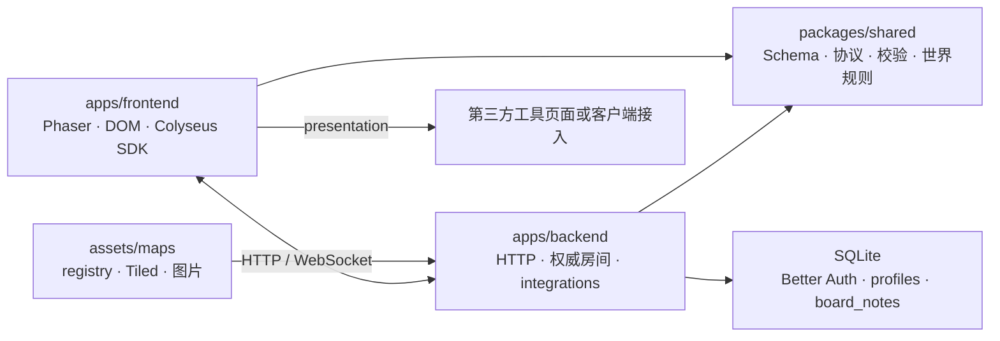
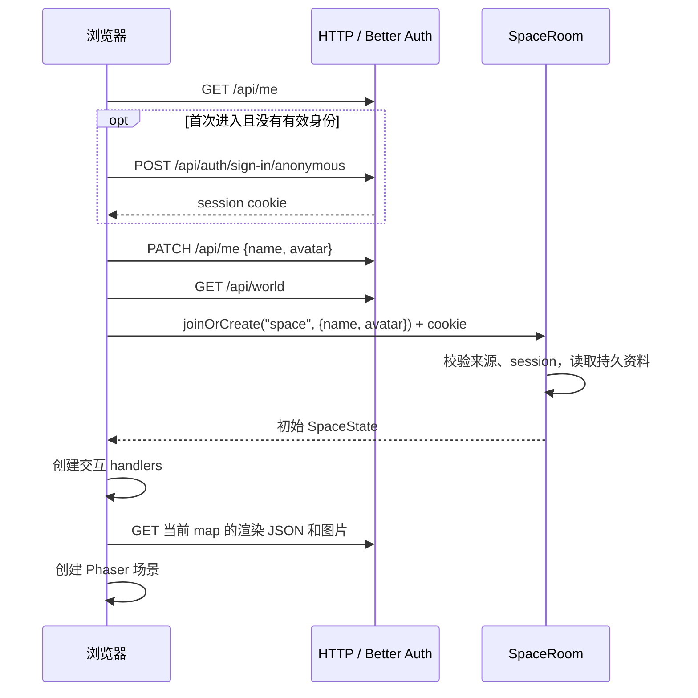

# 工程架构

本文描述当前代码的组织方式、运行流程和扩展契约。启动命令见 [README](../README.md)，地图格式见 [Tiled 契约](tiled.md)，身份 API 和绑定流程见 [身份说明](account-system.md)，工具配置见 [integration 配置](integration-plan.md)。尚未实现的能力见 [待办](roadmap.md)。

Virtual Workspace 由浏览器客户端和一个 Node.js 后端组成。浏览器使用 Phaser 4 渲染地图，通过 HTTP 获取身份、地图和工具配置，通过 Colyseus 0.18 WebSocket 收发输入、状态和交互请求。后端拥有玩家位置、地图归属和内置 integration 状态的写入权；SQLite 保存身份、资料和留言。Tiled 文件决定世界几何与交互语义，第三方服务拥有自己的内容、账号和权限。

## 1. 代码结构与依赖方向

仓库使用 npm workspaces，要求 Node.js 24 或更新版本，所有 workspace 启用 TypeScript strict。



前端不依赖 backend 包或服务端类型。客户端可见的 Colyseus Schema 和 `SpaceProtocol` 都从 shared 导出；数据库、认证 token 和服务端 handler 留在 backend。

| 路径 / 入口 | 职责 |
| --- | --- |
| [shared/index.ts](../packages/shared/src/index.ts) | Schema、消息输入校验、`WebTool` 配置类型、公共常量 |
| [shared/protocol.ts](../packages/shared/src/protocol.ts) | SDK 使用的 `SpaceProtocol` 结构类型，定义房间输入、请求响应及服务端消息 |
| [shared/world.ts](../packages/shared/src/world.ts) | Tiled 语义提取、registry 校验、动作锚点格判定、碰撞和移动函数 |
| [shared/character.ts](../packages/shared/src/character.ts) | 角色朝向和激活载荷的共享类型与校验 |
| [shared/interactions.ts](../packages/shared/src/interactions.ts) | 泛型 `InteractionRegistry<T>`，按 kind 注册、查询和遍历；拒绝空 kind 和重复注册 |
| [backend/app.config.ts](../apps/backend/src/app.config.ts) | 注册 `space` 房间、WebSocket transport 和 HTTP 路由 |
| [backend/rooms/SpaceRoom.ts](../apps/backend/src/rooms/SpaceRoom.ts) | 房间生命周期、身份复验、移动、聊天及交互授权上下文 |
| [backend/world.ts](../apps/backend/src/world.ts) | 读取地图 registry，生成权威世界和浏览器可加载的渲染资源 |
| [backend/interactions/index.ts](../apps/backend/src/interactions/index.ts) | 服务端交互组装入口；注册 board、pomodoro 和 Portal |
| [backend/interactions/context.ts](../apps/backend/src/interactions/context.ts) / [registry.ts](../apps/backend/src/interactions/registry.ts) | 服务端通用交互上下文、消息与生命周期组合 |
| [backend/interactions/web/config.ts](../apps/backend/src/interactions/web/config.ts) | 解析并校验公开 WebTool 配置 |
| [backend/identity.ts](../apps/backend/src/identity.ts) / [db.ts](../apps/backend/src/db.ts) | Better Auth、项目资料、数据库初始化和迁移 |
| [frontend/main.ts](../apps/frontend/src/main.ts) | 页面与连接生命周期、地图获取和切换、聊天、顶层清理 |
| [frontend/SpaceScene.ts](../apps/frontend/src/SpaceScene.ts) | Tiled 瓦片渲染、角色插值、键盘输入和区域通知 |
| [frontend/interactions/index.ts](../apps/frontend/src/interactions/index.ts) | 客户端交互组装入口；注册面板、Portal 和 WebTool handler |
| [frontend/interactions/dispatcher.ts](../apps/frontend/src/interactions/dispatcher.ts) | 通用区域、连接和销毁事件分发 |
| [frontend/interactions/board/handler.ts](../apps/frontend/src/interactions/board/handler.ts) / [pomodoro/handler.ts](../apps/frontend/src/interactions/pomodoro/handler.ts) / [portal/handler.ts](../apps/frontend/src/interactions/portal/handler.ts) | 内置面板和 Portal 客户端交互 |
| [frontend/interactions/web/handler.ts](../apps/frontend/src/interactions/web/handler.ts) / [web/presentations.ts](../apps/frontend/src/interactions/web/presentations.ts) | 按 resourceId 查找 WebTool 配置并呈现页面 |

shared 编译到 `packages/shared/dist`，同时输出 JavaScript 和声明文件；workspace 引用通过 package exports 读取这些产物。backend 使用 NodeNext，编译到 `apps/backend/build`；frontend 使用 Vite，产物位于 `apps/frontend/dist`。根脚本先构建 shared，避免其它 workspace 使用过期或缺失的协议产物。

`SpaceProtocol` 是显式维护的公共契约，并非从 backend 自动生成。修改消息时，需要同步 shared 的协议、输入校验和服务端实现。[架构测试](../apps/backend/test/architecture.test.ts) 在编译时比较两侧载荷及请求结果类型，同时检查前端没有 backend 依赖。

## 2. 启动与进入空间

后端入口 [index.ts](../apps/backend/src/index.ts) 调用 `listen(server, config.PORT)`。监听前，模块初始化完成以下工作：

1. [config.ts](../apps/backend/src/config.ts) 用 Zod 解析环境变量；生产环境检查身份配置。
2. 打开 SQLite，执行项目表迁移和 Better Auth 自身的 schema migration。
3. 读取 `MAP_REGISTRY_PATH` 指定的 registry 和所有地图，校验语义、默认 spawn 与 Portal 目标，建立渲染 JSON 和资源索引。
4. 解析 `EXTERNAL_TOOLS`，检查配置资源对应地图中的 `web` 区域。
5. 注册 HTTP 路由和 `space` 房间类型。具体房间由 matchmaking 按需创建。

数据库迁移、地图或工具配置出错会阻止正常启动。地图和配置在启动时读入内存；当前没有运行时重新加载机制，更改后需重启后端。

浏览器的进入流程由 `main.ts` 和 [identity.ts](../apps/frontend/src/identity.ts) 协作完成：



打开页面只尝试恢复已有资料；提交进入表单时才按需创建匿名身份并保存资料。客户端校验 `/api/world` 响应，等待房间初始状态后，用本玩家 `mapId` 选择地图；`initialMap` 是目录中的初始入口。

当前只有公共 `space` 房间类型，每房间最多 32 个连接。房间包含整个已登记地图集合；地图 ID 不是房间 ID。客户端调用 `joinOrCreate`，没有私密房间、成员名单或按地图创建房间的机制。

## 3. 世界数据：Tiled 到权威状态与画面

### 3.1 同一源数据的两种用途

[loadWorldRegistry](../apps/backend/src/world.ts) 对每个 registry 条目读取 `.tmj`，分别产生：

| 产物 | 消费方 | 内容 |
| --- | --- | --- |
| `WorldMap` | 服务端移动/授权；客户端区域及动作锚点显示 | 像素宽高、命名 `spawns`、碰撞矩形 `collisions`、交互矩形 `zones`、动作锚点 `actions` |
| 规范化 Tiled JSON | Phaser | 保留地图渲染数据；外置 JSON tileset 展开，图片路径改写为地图资源 API URL |
| 资源索引 | HTTP 资源路由 | 该地图显式引用的图片文件与服务端生成的 asset ID 对应关系 |

registry 配置条目是 `{ id, file, defaultSpawn }`，另有顶层 `initialMap`。`file` 相对 registry 文件所在目录解析；map ID 不要求与文件名相同。公共目录条目是 `{ id, url, defaultSpawn, world }`，不暴露源文件路径。客户端使用 `url` 获取渲染数据，无需知道默认示例地图的文件名。

registry 校验要求 map ID 唯一、initialMap 存在、各地图 defaultSpawn 存在，并逐一解析 Portal 的目标地图和 spawn。map ID、zone ID、spawn 名称采用非空、最多 128 字符的标识约束，已知资源型交互的 resourceId 也采用该约束；未知 kind 可不提供 resourceId。zone ID 和 spawn 名称在各自地图内唯一，resourceId 可以跨地图复用。

所有坐标和移动规则使用像素。标准 tile 为 16×16；地图宽高从 tile 数换算为像素。tile 不直接决定碰撞，服务端碰撞来自 Tiled 的语义对象层。

### 3.2 项目语义校验

`parseWorldMap` 要求有限、正交、16×16 tile 的地图，以及以下三个对象层。层名在整张地图中各出现一次，可以嵌套在 group 中；group 和 layer 的位置偏移会累加到语义坐标。

| 对象层 | 提取规则 |
| --- | --- |
| `spawns` | 至少一个命名 point；名称唯一，按玩家碰撞体检查可站立性 |
| `collisions` | 地图内的非旋转、正面积轴对齐矩形；可为空 |
| `interactions` | 区域为地图内的非旋转、正面积轴对齐矩形；动作锚点为可站立的点；可为空；对象 `name` 是该地图内唯一的交互对象 ID |

`interactions` 层也可包含动作锚点：`class` 为 `action` 的对象必须是命名 point，string property `action` 指定动作名称。可选 `facing` 覆盖朝向，`offsetX`/`offsetY` 指定世界像素偏移，`linkedObjectId` 保留地图对象关联。有效锚点必须可站立；每个动作名称在每个 16×16 格最多一个锚点，不同动作可共格。动作只按角色脚点所在格查找，不使用距离半径；命中后服务端吸附到偏移后的锚点并采用可选朝向，未命中则原地执行并保留朝向。ID 在地图间可重复，运行时状态通过 map ID 隔离。

交互 kind 取对象 `class`，没有 class 时使用 `type`；properties 保存为 `Record<string, unknown>`。`resourceId` 是从 properties 提取的共享资源标识，与 zone ID 不同：多个区域或地图可以引用同一资源。Portal 使用 `targetMap` 和 `targetSpawn`。

已注册的交互定义负责 kind 特有的语义校验。当前 `interactionDefinitions` 在 shared/world.ts 中集中注册：board、pomodoro 和 `web` 检查非空 resourceId，Portal 检查目标属性。未知 kind 仍可解析，不因缺少内置 handler 而拒绝地图；若需要特定属性约束，应注册定义，或向 `parseWorldMap` 传入自定义 registry。定义注册不会自动创建客户端或服务端 handler。

校验范围与渲染能力分开。其它对象层中的装饰对象保持不透明，不套用语义矩形约束；多个 tile layer、多个 tileset 或额外 Tiled 元数据也不会仅因当前画面不需要而被语义解析器拒绝。语义层的可见性不控制碰撞或授权。

一个位置只激活一个 zone：服务端取解析顺序中第一个包含玩家中心点的矩形。包含判断左/上边界闭合、右/下边界开放；重叠区域没有独立优先级配置，制图时应考虑对象顺序。

### 3.3 渲染加载和支持边界

后端支持内嵌 tileset 和外置 JSON `.tsj`，解析其图片引用，递归改写 group 内 image layer 的图片路径。资源路由仅接受已建立索引的 map/asset ID；没有任意文件路径下载接口。地图与 tileset 是部署者控制的可信文件，加载器允许其引用文件系统资源，制图文件本身不是面向不可信上传的沙盒。

`SpaceScene.preload` 把规范化 JSON 交给 Phaser Tiled parser，并加载带顶层 `image` 的 atlas tileset。`create` 按 Phaser 解析得到的 tile layer 顺序创建图层，使用全部已加载 atlas；不要求图层叫 ground，也不要求只有一张内嵌 tileset。玩家和交互区提示在瓦片层之后绘制。

当前实现覆盖 atlas tileset、多个瓦片层及 group 内的瓦片层。外置 XML `.tsx` 没有转换器；image collection tileset、image layer 和 tile object 没有相应的客户端绘制实现。后端保留/改写这些数据不表示前端已经支持绘制。新增 Tiled 视觉支持应改动加载或渲染路径，不应顺便收紧无关语义校验。

地图逻辑尺寸来自 registry 中的 world。浏览器相机缩放由 `VITE_CAMERA_ZOOM` 单独配置，默认值为 2；仅接受有限且大于零的数字，其它值回退到 2。该值不依赖地图 tile 尺寸。Phaser camera zoom 同时作用于地图、角色和对象视觉，Tiled 像素坐标、出生点、碰撞和服务端移动规则保持原值。昵称与区域文字按屏幕尺寸保持可读。registry 不限制地图纵横比；全屏画布由 RESIZE 适配窗口。

## 4. 实时状态、移动与地图切换

### 4.1 同步状态和消息

`SpaceState` 包含以下集合，由服务端写入并通过 Colyseus Schema patch 同步：

| 字段 | 键与值 | 范围 |
| --- | --- | --- |
| `players` | Colyseus `sessionId` → `Player` | 当前房间全部玩家，含不同地图的玩家 |
| `notes` | note UUID → `BoardNote` | registry 内 board 资源的留言快照 |
| `pomodoros` | `resourceId` → `Pomodoro` | 当前房间的共享计时器 |
| `serverTime` | 服务端时间戳 | 番茄钟显示使用的时间基准 |
| `worldObjects` | map ID → `MapObjectState`（authored object ID → `{ variant, occupiedBy }`） | 房间内各地图对象的共享视觉变体和占用状态；动作锚点、区域及关联对象 ID 均预留状态 |

Player 包含 `userId`、昵称、地图角色原型 ID `avatar`、JSON 字符串形式的 `appearance`、权限 role、`mapId`、坐标、`connected`、`zoneId`、`facing`、`motion`、动作名 `action`、`actionAnimated` 和 `actionTargetId`。appearance 由共享 `appearanceSchema` 校验，包含 body、face、hair、top、bottom、shoes 六层的素材 ID 和 RGB 颜色；动作默认为 `none`，动画标记默认为 `false`；移动会重置这三项。地图和定制预览绘制相同的完整帧图层并逐层乘色。`avatar` 不表示个人头像或权限。`userId` 是持久身份；Colyseus `sessionId` 是连接标识；Better Auth 的 session ID 是认证会话标识。三者用途不同，消息 handler 从 Colyseus 提供的 client 和已验证身份定位操作者。

消息载荷是普通对象，Schema 只用于同步状态。前端通过 `send` 提交 input/chat，通过 `request` 调用 boardPost、boardDelete、pomodoro、portal 和 activateAction，后者返回 `{ ok, message }`。activateAction 只接收动作名和可选动画标记；地图与玩家位置由服务端权威读取。服务端 chat 是实时广播；聊天记录不放入 Schema，也不落盘。浏览器只保留本次连接显示的最近 100 条。

| 消息名 | 客户端载荷 | 服务端效果 |
| --- | --- | --- |
| `input` | `{ x, y }` 方向 | 更新该连接的最近输入，不接收客户端坐标 |
| `chat` | `{ text }` | 生成 ID、作者名和时间，向整个房间广播 |
| `boardPost` | `{ resourceId, text }` | 以已验证作者身份写入留言 |
| `boardDelete` | `{ resourceId, id }` | 检查作者或 admin 权限后删除 |
| `pomodoro` | `{ resourceId, action, mode? }` | start/reset 要求 mode；pause/resume 不接收客户端剩余时间 |
| `portal` | `{ zoneId }` | 使用服务端地图属性选择目标及出生点 |
| `activateAction` | `{ action, animated? }` | 按当前位置所在格和动作名查找锚点；匹配后权威吸附并可覆盖朝向，否则原地执行 |

当前没有按地图或资源进行 Schema 的可见性过滤。客户端只绘制同 mapId 的玩家、只展示当前 resourceId 的留言；同房间客户端仍接收其它地图玩家和所有已同步 integration 数据。区域检查约束操作，不是读取隔离；地图转换也不隔离聊天。

### 4.2 权威移动

前端发送 `{ x, y }` 方向输入，两轴均为 -1、0 或 1。输入变化时立即发送，持续输入每 100ms 刷新；表单获焦、页面失焦或隐藏时停止移动。断线时不提交新的移动输入。

`SpaceRoom` 校验输入和身份后，保存该连接的最近方向及接收时间。每 50ms 更新一次权威移动，state patch 间隔也是 50ms；输入超过 250ms 未更新或玩家已断线时停止推进。

[stepMovement](../packages/shared/src/world.ts) 将斜向输入归一化，以 150 像素/秒移动；单步 delta 限制在 0–50ms，依次尝试 X、Y 方向，允许沿墙滑动。玩家坐标表示地面脚点，碰撞使用固定 12×8 像素的轴对齐地面矩形：横向从脚点 x−6 到 x+6，纵向从 y−8 到脚点 y。该尺寸独立于地图 tile 和角色图片；边界及 collision 矩形都由当前 mapId 对应的 `WorldMap` 决定。移动后，服务端重新计算 zoneId。

客户端对服务端位置做线性插值，无本地预测或重演。全屏画布使用 RESIZE，镜头在地图范围内跟随当前玩家；键盘和屏幕方向按钮提交相同的 input，松开、页面隐藏或失焦会停止输入。`facing` 由方向输入更新，`motion` 表示 idle/walk；激活动作时服务端同步动作、动画标记和目标对象 ID，并按锚点规则调整位置与朝向。非零移动会清除动作状态。场景中的区域通知使用服务端 zoneId；界面提示和按钮状态不会替代服务端位置校验。

角色素材由 [characters.ts](../apps/frontend/src/characters.ts) 配置帧尺寸与帧内地面脚点；这些值独立于地图 tile 与碰撞尺寸。约定图集为 4 列：前四行按 down/left/right/up 排列行走帧，第五至八行按同样方向顺序排列 sit 帧；后续动作在角色配置中增加对应的四个方向行；idle 和静态动作使用各行第一帧，走路使用列 1–4，动画动作使用列 2–4。动画帧由客户端本地时间选择，不进入 Schema。目前所有角色图层都是 64×192，帧尺寸 16×24。body 使用 `walk.png`，原 `eyes.png` 作为完整帧 face 图层，其他素材由 `appearance.assetId` 选择；各层使用同一帧号、位置和脚点。mint、amber、violet 是保留的角色原型 ID；实际外观由 appearance 决定。

`Tiled 对象 → interaction → worldObjects 状态 → 视觉表示` 是对象呈现的数据路径。动作锚点可保留 `linkedObjectId`，WorldObjectState 按地图和 authored ID 保存对象 variant，以支持后续变体切换；当前动作不执行脚本，也不改变桌面行为。`worldObjectVisuals.ts` 保留按 authored ID 和 kind/variant 绘制叠加图的能力。叠加视觉尺寸单独定义，不依赖 tile 尺寸；业务 handler 只修改对象状态，不写 GID 或调用 putTileAt。

### 4.3 Portal 的完整路径

1. 玩家进入 Portal，服务端同步 zoneId。
2. 客户端 [PortalInteraction](../apps/frontend/src/interactions/portal/handler.ts) 对本次区域进入发送一次 `portal` 请求，载荷只有 zoneId。
3. 服务端复验身份，按当前 mapId 与真实坐标寻找区域，检查 zone ID/kind、连接状态和操作间隔。
4. [Portal handler](../apps/backend/src/interactions/portal/handler.ts) 从服务端 Tiled 属性读取目标地图和命名 spawn，更新 mapId、坐标和 zoneId，并清除旧移动输入。
5. `main.ts` 观察本玩家 mapId，清除当前交互区域，获取目标渲染 JSON，销毁旧 Phaser Game 并创建新场景。异步加载以 generation 和 room 引用检查丢弃过期结果。

Portal 保留同一房间、连接、身份和聊天。加入房间使用 initialMap 的 defaultSpawn；Portal 使用其明确指定的 targetSpawn，不强制使用目标地图默认出生点。目标地图和 spawn 在启动时已验证。失败请求不会改变地图；客户端需要重新进入区域才再次尝试。

### 4.4 断线和资源清理

后端 `onDrop` 标记玩家 disconnected 并删除移动输入，对允许重试的网络 close code 提供 20 秒重连窗口；SDK 在同一 Room 实例上自动重试。`onReconnect` 再检查身份，恢复 connected。最终 `onLeave` 才删除玩家、身份引用和限流记录；`onDispose` 调用各 integration 的清理钩子。

浏览器断线时禁用聊天和交互控制，重连后恢复。最终离开时，`main.ts.cleanup` 使未完成地图加载失效，dispose dispatcher，销毁 Phaser Game，并复位连接与页面状态。交互 handler 负责移除自身 DOM 监听、房间订阅、计时器和 iframe。外置工具面板会 abort 配置 fetch；内置面板与 Portal 不取消已发出的 `room.request`，而是在销毁或区域变化后忽略迟到响应的界面更新。清理是 handler 接入契约的一部分。

## 5. Interaction 与 presentation 扩展

### 5.1 四个接入点

`InteractionRegistry<T>` 是通用容器，不是自动发现插件的系统。以下 registry 各自保存不同契约，按职责独立组装：

| 接入点 | 注册内容 | 调用方式 |
| --- | --- | --- |
| shared `interactionDefinitions` | `validate(zone)` | Tiled 语义解析时按 kind 调用 |
| frontend `interactions/index.ts` | `InteractionHandler` | 组装 handlers；dispatcher 路由区域、连接和销毁事件 |
| backend `interactions/index.ts` | 消息字典及生命周期钩子 | `SpaceRoom` 合成消息并调用 initialize/tick/dispose |
| frontend `web/presentations.ts` | WebTool 展示实现 | WebTool handler 按 mode 展示、清理页面 |

客户端 [InteractionDispatcher](../apps/frontend/src/interactions/dispatcher.ts) 只认识 `setZone`、`setConnected`、`dispose`。切换区域先向旧 handler 传 `undefined`，再通知新 handler；同一 handler 可注册到多个 kind，连接/销毁广播按实例去重。未知 kind 没有对应 handler 时，不显示专属交互界面。

board 和 pomodoro 分别使用 [BoardInteraction](../apps/frontend/src/interactions/board/handler.ts)、[PomodoroInteraction](../apps/frontend/src/interactions/pomodoro/handler.ts)，共用 [panel.ts](../apps/frontend/src/interactions/panel.ts) 的连接、pending、反馈和订阅清理机制。它们在 interactions/index.ts 直接注册，其现有 UI 不通过 WebTool 配置选择模式。Portal 使用 [portal/handler.ts](../apps/frontend/src/interactions/portal/handler.ts) 独立注册。`web/handler.ts` 读取 `/api/tools`，按资源匹配配置。角色动作由客户端 actions 模块提交 `activateAction`，载荷不含地图对象 ID 或客户端坐标；地图不是客户端动作 handler 的依赖。

服务端 [registerServerInteractions](../apps/backend/src/interactions/registry.ts) 合并 handlers 的消息字典，保留具体消息类型，拒绝重复消息名。kind 注册只关联生命周期；实际请求按消息名进入对应 handler。通用容器不会自动执行身份或位置检查。区域 handler 调用上下文中的 `authorize` 和 `check`；动作 handler 使用同一身份复验和操作限流，再按动作名与所在格查找地图锚点。

上下文提供 state、地图语义、身份复验和区域检查；Portal 另需要 map 索引与移动重置函数。房间在创建时调用 initialize，每秒及新玩家加入时调用 tick，销毁时调用 dispose。业务规则由 handler 和其 store 承担，SpaceRoom 提供通用授权与生命周期。

### 5.2 embed / external

所有外置工具区域使用 Tiled 类型 `web`，并以 `resourceId` 匹配 `EXTERNAL_TOOLS` 中的 `WebTool`。配置不声明 kind；具体服务由 URL 决定。`mode` 省略时默认为 `external`。

| mode | 当前实现 | 配置要求 |
| --- | --- | --- |
| `embed` | 在宿主中创建 iframe，离开时移除 | 必须有 HTTP(S) URL |
| `external` | 显示新标签页链接，使用 `noopener noreferrer` | 必须有 HTTP(S) URL |

展示实现签名为 `(tool, host) => cleanup`。presentation registry 注册 embed 与 external 展示策略；外置配置只选择这两种方式。需要自定义展示时，创建并注入 registry：

```ts
const presentations = new PresentationRegistry()
  .register('embed', renderEmbed)
  .register('external', renderExternal);
const interactions = createInteractions(room, presentations);
// renderEmbed / renderExternal 接收 WebTool 与宿主元素，并返回清理函数。
```

`fallback: 'external'` 可选，仅对 embed 生效：iframe 旁显示手动打开链接，不检测加载失败，也不自动切换。external 需要 URL；embed 同样需要 URL。

iframe sandbox 仅开放 `allow-scripts allow-forms allow-popups`，不开放 `allow-same-origin`，referrer policy 为 `no-referrer`。第三方 CSP、登录或浏览器能力要求可能使其无法嵌入，应选 external。项目不代理工具流量、不管理容器、不签发工具凭据或映射跨服务身份与权限。

### 5.3 增加交互时的修改顺序

1. 定义 Tiled kind 和所需 properties；有特定语义约束时注册 `InteractionDefinition`。
2. 定义 shared 输入校验、请求结果和 `SpaceProtocol` 消息；仅需本地展示的交互可省略服务端消息。
3. 在 backend/interactions 实现需要的业务规则和存储，注册消息与生命周期；受保护操作使用已验证身份和当前位置。
4. 实现前端 `InteractionHandler`，在 `interactions/index.ts` 注册；外置页面使用 `web` handler 和按 `resourceId` 配置的 WebTool。
5. 为语义、授权、资源共享范围和清理行为添加对应测试。通用 dispatcher 和 SpaceRoom 的生命周期遍历通常无需增加业务分支。

## 6. 身份、权限和数据生命周期

Better Auth 负责匿名 user、session cookie、一次性绑定码及凭据校验，未打包进浏览器。session 有效期为 30 天，cookie cache 关闭；绑定码使用哈希存储，有效期 3 分钟且单次兑换。新设备兑换后共享同一认证 session，撤销它会影响所有绑定设备。正式注册、登录和账号恢复尚未实现。

`SpaceRoom.onAuth` 从 HTTP headers/cookie 验证身份并检查提供的 Origin，不接受客户端声明的 userId 或 role。入房时保存服务端验证得到的认证 session 引用；每条受保护消息及每秒巡检通过 Better Auth adapter 复验有效性，再读取最新 profile。资料和角色因此可在线更新；失效连接会被关闭。前端检查只改善交互反馈。

区域交互检查按玩家真实 mapId/位置确认 kind 和 resourceId；动作锚点由服务端按角色实际位置所在格与动作名匹配。两者共享每连接至少 500ms 的操作间隔。聊天另有每连接 500ms 间隔。管理员不会绕过身份、位置或限流。`avatar` 是角色原型 ID；`appearance` 是单独校验并共享的换装配置。两者都与权限 `role` 分离。

| 数据 | 持久化和共享范围 | 实现 |
| --- | --- | --- |
| auth user/session/verification 等 | SQLite；跨浏览器绑定共享身份 | Better Auth |
| 昵称、avatar ID、appearance、member/admin role | SQLite profiles；按持久 userId | identity.ts；换装选项由共享 Schema 校验；role 通过本地 CLI 更新 |
| 玩家脚点、mapId、appearance、zoneId、connected、facing、motion、action/actionAnimated/actionTargetId | 房间内存；网络重连可保留，最终离开后删除 | SpaceRoom / Player Schema |
| 对象 variant/occupiedBy | 房间内存；按地图与 authored ID 共享，房间销毁后重置 | SpaceState.worldObjects / action handler |
| 聊天 | 房间广播；没有服务端历史 | SpaceRoom |
| 留言 | SQLite board_notes；同一进程所有房间按 resourceId 共享 | [BoardStore](../apps/backend/src/interactions/board/store.ts) |
| 番茄钟 | 每房间按 resourceId 共享；房间销毁或服务重启后重置 | [pomodoro handler](../apps/backend/src/interactions/pomodoro/handler.ts) |
| 地图目录和工具配置 | 启动时载入；整个后端实例共享 | [world.ts](../apps/backend/src/world.ts) / [web/config.ts](../apps/backend/src/interactions/web/config.ts) |
| 第三方内容及工具会话 | 第三方服务拥有 | 不写入项目 Schema 或数据库 |

留言写入后，进程级 BoardStore 通知所有活跃房间的 board handler 更新 Schema。容量检查和插入在 SQLite 事务中完成，每资源最多 100 条；作者依据持久 userId 删除，admin 可删除其他作者留言。旧记录的 author_user_id 保持 NULL，不按昵称认领；Schema 中对应空字符串。详细规则见 [integrations](integrations.md)。

番茄钟以服务端 endsAt 为准，handler 每秒更新 serverTime 和完成状态。前端用收到的服务端时间加本地单调时间推算显示，每 250ms 刷新；这只影响显示，暂停/继续/重置都由服务端决定。同一房间中跨地图引用同一 resourceId 的区域共用计时器。

项目表由 `PRAGMA user_version` 的 v1–v4 迁移管理；v4 为 profiles 增加 `appearance_json`；Better Auth 表单独通过库的 migration 管理。SQLite 启用 WAL、外键和 5000ms busy timeout；管理员 CLI 可在线修改角色。迁移应在备份后执行，数据库持久化路径由 `DATABASE_PATH` 指定。

## 7. HTTP 接口和部署边界

[app.config.ts](../apps/backend/src/app.config.ts) 提供以下项目接口，`/api` 响应设置 `Cache-Control: no-store`：

| 接口 | 访问与用途 |
| --- | --- |
| `GET /api/world` | 公开地图目录与所有权威地图语义 |
| `GET /api/maps/:id/map.json` | 公开规范化 Tiled JSON；未知地图返回 404 |
| `GET /api/maps/:id/assets/:asset` | 已登记图片资源；未知资源返回 404 |
| `GET /api/tools` | 公开工具 resourceId、mode、URL 和 fallback；不能放凭据 |
| `GET /api/me` | 有效身份的 profile；可转发认证库刷新后的 Set-Cookie |
| `PATCH /api/me` | JSON 更新昵称/avatar/appearance，校验提供的 Origin，不接受 role 更新 |
| `/api/auth/*` | 只开放匿名登录、session 查询、退出和绑定码生成/兑换的指定方法，其余返回 404 |
| `GET /health` | 执行 SQLite `SELECT 1` 后返回状态 |

项目 `/api` JSON parser 的请求体限制为 16KB；auth 路由在它之前交给 Better Auth 处理。Colyseus 自身提供 matchmaking 与 WebSocket 路由。`VITE_SERVER_URL` 仅改变 Colyseus 连接目标，身份、地图和工具 API 始终请求当前页面同源 `/api`；改变连接地址时需确保两侧服务使用一致的身份和地图配置。

开发时 [vite.config.ts](../apps/frontend/vite.config.ts) 代理 `/api`、`/health`、`/matchmake` 和 Colyseus WebSocket。Vite 的 publicDir 指向根 assets，构建也会复制其中的资源；运行时地图选择仍通过后端目录。生产环境 `npm start` 只启动 backend，前端静态产物需单独托管；registry、地图、tileset 和图片文件也必须随后端部署。

当前部署模型为单后端实例和本地 SQLite。房间状态、BoardStore 通知和配置索引都在进程内；直接增加多个进程无法保留现有跨房间共享语义，需要另行设计房间调度、持久化和变更通知。HTTP Basic Auth 由部署者的反向代理提供。身份 secret、公开站点 URL 和 trusted origins 的部署要求见 README 与身份说明。

## 8. 验证与定位问题

文档和代码的关键契约由以下检查覆盖；运行方法及完整覆盖边界见 [测试说明](testing.md)。

| 修改范围 | 优先核对 |
| --- | --- |
| Schema / 消息 | `protocol.test.ts`、`architecture.test.ts` 和 strict 类型检查；前后端载荷是否同步 |
| 地图语义 / 移动 | `world.test.ts`；单位、偏移、碰撞边界、未知 kind 与无关 Tiled 元数据 |
| 地图加载 / Portal | `portal.test.ts` 和浏览器地图切换用例；目标验证、资源 API、身份与房间保留 |
| interaction handler | `space.test.ts` / `db.test.ts`；身份、权限、位置、限流和持久化范围 |
| presentation / 清理 | `architecture.test.ts` / `web-tools.test.ts` / 浏览器用例；策略选择、embed 的手动 fallback 和离开清理 |

`npm run check` 执行类型检查、Node 测试和构建；`npm run test:e2e` 使用独立开发服务、内存数据库和临时多地图 fixture。测试世界不向默认示例地图添加测试 Portal。第三方页面用替身验证展示契约，不验证真实编辑、绘画或同步播放。浏览器测试当前只覆盖 Chromium，触屏移动、其它浏览器和弱网络压力仍需额外验证；仓库尚无 CI 配置。

排查时沿数据流定位：启动失败先检查 config、迁移和 registry；画面与碰撞不一致时分别检查渲染 JSON 与 `WorldMap`；请求被拒绝时检查已验证身份、真实 mapId/位置、资源匹配和限流；切换后出现旧界面时检查 handler 清理与异步 generation 检查。工具页面自身的登录或协作问题应在对应服务中定位。
