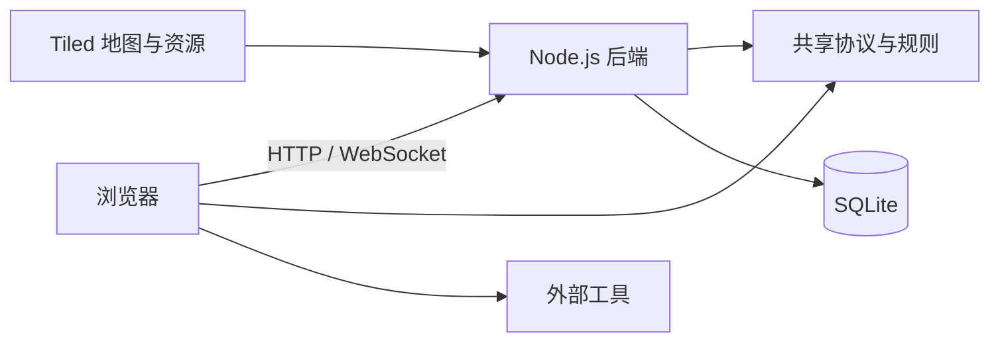

# 工程架构

本文说明系统由哪些部分组成、关键数据由谁负责，以及功能如何接入。启动与部署见 [README](../README.md)，地图制作见 [Tiled 地图说明](tiled.md)，账号规则见 [账号说明](account-system.md)，外部服务入口见 [配置契约](external-tools.md)。

## 系统组成

Impartation 由浏览器前端、Node.js 后端、共享协议包和地图资源组成。浏览器通过 HTTP 获取账号、地图和入口配置，通过 Colyseus WebSocket 加入实时空间。

| 部分 | 职责 |
| --- | --- |
| `apps/frontend` | 账号界面、Phaser 地图场景和 Colyseus 客户端 |
| `apps/backend` | 身份 API、权威实时状态、地图服务和内置交互 |
| `packages/shared` | 前后端共用的协议类型、Schema 和地图规则 |
| `assets/maps` | 地图 registry、Tiled 文件、tileset 与地图图片 |
| SQLite | 账号资料、已保存造型、留言及管理命令 |
| 外部服务 | 自行管理其内容、账号、权限和持久化 |

前端只依赖 `packages/shared` 导出的协议类型，不依赖 backend 源码类型。房间协议由 shared 显式维护；新增或修改消息时，前端类型、服务端校验和处理逻辑需保持一致。

## 加入空间与地图

地图 registry 定义有序 Space 列表，以及每个 Space 可用的地图、初始地图和默认出生点。客户端读取 `/api/world` 展示 Space；用户选择后，服务端验证账号 session 和 `spaceId`，再加入该 Space 的 Colyseus room。

每个 Space 同时最多有一个 live room。room 负责该 Space 的玩家、聊天、语音信令、地图对象状态和临时交互状态。玩家可以在 Space 登记的地图间切换；地图切换保留当前 room 和账号连接。Portal 与地图菜单快捷切图最终都由服务端验证目标地图和出生点。

服务端从 Tiled JSON 建立两种数据：供移动、碰撞和交互校验使用的地图语义，以及供浏览器渲染的规范化地图数据。服务端拥有位置、身份、地图归属和交互授权的写入权；客户端提交输入并显示同步状态。地图格式、制作要求和渲染边界见 [Tiled 地图说明](tiled.md)。

## 状态归属与隔离

| 数据 | 归属与生命周期 |
| --- | --- |
| 账号、profile、造型槽 | Better Auth 与 SQLite；按账号持久化，跨 Space 共用 |
| 玩家位置、聊天、语音信令 | 当前 Space room；Space 间隔离，room 销毁后不恢复运行态 |
| 地图对象、动作占用、私密区域会话 | 当前 Space room，按 map ID 隔离 |
| 留言 | SQLite，按 `(space_id, resourceId)` 持久化 |
| 番茄钟 | 当前 Space room，按 `resourceId` 共享；room 重建后重置 |
| 地图与 WebTool 目录 | 后端启动时载入，整个实例共用 |
| 外部工具内容 | 对应外部服务负责；项目只保存公开入口配置 |

身份来自服务端验证的 Better Auth session。客户端提交的 user ID、昵称或权限角色不构成授权依据。每次受保护的实时操作，服务端结合已验证身份、权威位置和交互规则判断是否允许。

私密区域是同一 Space room 内的临时成员上下文，不是单独的房间或账号级 ACL。服务端限制入场并按区域过滤聊天和语音接收；位置、正在输入标识等同步状态仍对同一 room 的成员可见。身份和权限细节见[账号说明](account-system.md)，内置工具与外部服务边界见[集成说明](integrations.md)。

## 交互扩展边界

地图交互由 Tiled `interactions` 对象层声明。shared 提供泛型 `InteractionRegistry<T>` 描述交互定义；前端和后端分别在各自的 `interactions` 模块组装实现。

服务端交互负责校验身份、地图位置、权限和业务输入。客户端 handler 负责呈现界面、发送请求及清理订阅和 DOM。交互离开区域、断线或销毁时必须清理自身资源。共享资源通过 `resourceId` 关联；地图对象 ID 用于定位地图内状态，不替代身份或权限校验。

项目内置 Portal、留言板、番茄钟、衣柜、动作锚点、变体选择和私密区域。外部入口统一使用 `web` 类型，按 `resourceId` 读取 `EXTERNAL_TOOLS`；点击后可打开新标签页或 sandbox iframe。项目不代理外部服务流量、不映射项目身份，也不管理工具容器。配置及浏览器安全边界见[外部工具配置](external-tools.md)。

## 部署边界

当前部署模型是单个后端实例和本地 SQLite。Space room、排队状态和运行中的交互状态保存在进程内；增加后端副本前，需要先设计跨进程房间调度、持久化和状态通知。SQLite 数据目录需要持久化与备份；HTTP Basic Auth（如需）由部署者的反向代理提供。

HTTP API 提供公开地图目录、规范化地图资源、公开 WebTool 配置和 WebRTC ICE 配置；账号及管理员 API 由服务端 session 保护。地图和工具配置在启动时读取，变更后需重启后端。具体环境变量、代理和部署步骤见 README 与[托管指南](hosting.md)。

测试命令、覆盖范围和自动化验证边界集中记录在[测试说明](testing.md)。
